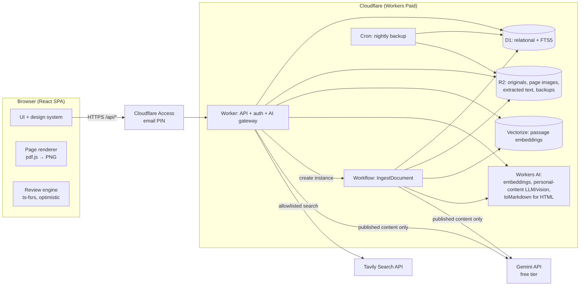

# Studypoint — Architecture

| | |
|---|---|
| Status | **Approved v1.0**, 2026-11-25 |
| Implements | [[PRD]] (requirement IDs referenced inline) |
| Related | [[DATABASE]], [[AI_SYSTEM]], [[DESIGN]], [[TESTING]], [[RESEARCH]], [[SOURCES]] |
| Plan assumption | **Cloudflare Workers Paid** ($5/mo, purchase planned for early December 2026) |

---

## 1. System overview



**In one paragraph:**
- A single Cloudflare Worker serves the React SPA (static assets) and the `/api/*` routes behind Cloudflare Access.
- Uploads go to R2. A **Cloudflare Workflow** runs ingestion as durable, retryable steps: extract → OCR → chunk → embed → index.
- Relational data and keyword search live in **D1** (FTS5). Semantic search lives in **Vectorize**.
- Every AI call goes through one **AI gateway** module, which routes by content privacy (`PRV-02`). Personal content can only reach Workers AI. Published content may go to Gemini.
- FSRS scheduling runs in the browser for instant review, and the server stores the authoritative review log.

## 2. Key decisions (ADR log)
Each entry gives the context, the decision and its consequences. Never rewrite an entry; add a new one that supersedes it.

| # | Decision | Why | Trade-off accepted |
|---|---|---|---|
| A1 | **Cloudflare Workers Paid** as the platform | Alex knows the stack. Access, D1, R2, Vectorize, Workflows and Workers AI are all in one account. Paid lifts CPU to 30 s (up to 5 min) per request and Workflow step | $5/mo. Lock-in reduced by plain SQL and portable exports (`EXP-01`) |
| A2 | **Single Worker** serving the SPA + API (`assets.run_worker_first: ["/api/*"]`), as in Prizm, on a free `studypoint.<subdomain>.workers.dev` address with Access enabled on that route | One deploy unit and one Access application | The API and UI deploy together (fine for one user) |
| A3 | **Cloudflare Access + JWT verification + `ALLOWED_EMAILS`**, copied from the NoteFlare pattern | No auth code to get wrong. Verified in [RESEARCH §6](RESEARCH.md) | Sign-in UX is Cloudflare's page, not custom |
| A4 | **Workflows** for ingestion (not plain Queues) | Multi-step, failure-prone, rate-limited pipeline. Steps persist and retry, and `step.sleep` gives free-tier AI backoff without burning CPU. Limits: 10k steps, 30 s–5 min CPU per step, 1 MiB per step result | Step results must be small: pass **R2 keys**, not content |
| A5 | **Pages are rendered to images in the browser** (pdf.js + canvas) at upload, then stored in R2 | Workers have **no canvas**, so unpdf can't render pages server-side. Page images are needed for OCR/vision, for citation highlighting and for image occlusion (P2) | Upload takes longer in the browser (progress shown). Server-side text extraction still uses unpdf |
| A6 | **Hybrid retrieval**: D1 FTS5 (keyword) + Vectorize (semantic), merged with reciprocal-rank fusion | Exact terms (formula names, symbols) need keyword search. Concepts need vectors. Keeps working if vector capacity runs short | Two indexes to keep in sync (they share one write path in the Workflow) |
| A7 | **One AI gateway module** with typed privacy-tagged inputs | Makes `PRV-02` structurally hard to break, swaps providers by config (`NFR-PORT`), and gives one place for rate limits, usage metering and logging | Features can't call provider SDKs directly (enforced by the repo audit) |
| A8 | **REST calls, no AI SDKs** (Gemini REST, Tavily REST, Workers AI binding), as in Prizm | Smaller bundle, no Node-only dependencies, works on Workers | We maintain thin client code |
| A9 | **Tavily** for trusted web search (`LKP-01`) | `include_domains` (max 300) / `exclude_domains` (max 150), optional raw page content, **1,000 free credits/month** with no card, 1 credit per basic search | Third-party dependency. The allowlist is **also enforced in our code** (A10) because an API parameter isn't a guarantee |
| A10 | **Defence-in-depth allowlist**: an API filter, then post-filtering on the final resolved URL's registrable domain, then a blocklist check on redirects | "Ultra-reliable sources only" must not depend on a vendor behaving | Slightly fewer results |
| A11 | **FSRS (ts-fsrs) runs on the client and is recomputed on the server** | Rating feels instant (`NFR-PERF`). The server is the source of truth for the review log and recomputes card state from it | ts-fsrs ships in both bundles (small) |
| A12 | **React Router (SPA mode)** instead of Prizm's state switch | Citations need deep links (`/source/:id?page=12&passage=…`) and back-button behaviour | One more dependency than Prizm |
| A13 | **TanStack Query** for server state | Caching, optimistic updates for reviews, and retries | A learning curve vs plain fetch |
| A14 | **Erasable-only TypeScript** (no `enum` or `namespace`), as in Prizm | Lets the Python + headless-Chromium local test harness strip types without Node | Write string-union types instead of enums |
| A15 | **AI-rendered Markdown is sanitised** (rehype-sanitize allowlist) before display | AI output and imported web pages are untrusted, which is an XSS risk | Some exotic Markdown won't render |

| A16 | **Bundled college directory** as a versioned static asset (`/data/institutions-<year>.json.gz`), built from federal College Scorecard/IPEDS bulk data by `tools/build_institutions.py` (`INS-01/07`) | About 6–7k US colleges including 2-year schools. No API key, instant typeahead, and it keeps the D1 "starts empty" rule (`LIB-12`), because reference data isn't stored as seed rows | Refreshed yearly by hand. Loaded only on setup and Settings → School (lazy, roughly 150–250 KB gzipped, **to verify** after building) |
| A17 | **Course-code lookup on the school's own domain only** (`INS-03/04`), using Tavily `include_domains=[school domain]` plus a code post-filter, a Worker fetch with a fallback to Tavily `raw_content`, then Gemini extraction (published content) with verbatim checks | No nationwide catalog dataset or API exists (only partial projects and scrapers). The school's site is the authoritative source | Some catalogs block bots (UMBC's returned 403 to our fetch). That's why there are fallbacks: pasted URL or text, or manual entry |

Open items moved to later docs: the embedding model and dimensions, and the chat default for mixed-privacy context (`PRV-03`) → [[AI_SYSTEM]].

## 3. Components

### 3.1 Client (React SPA)
- **Stack:** React 19, TypeScript (erasable only), Vite, Tailwind v4, `@cloudflare/vite-plugin`, React Router, TanStack Query, KaTeX (HTML + MathML output for `UX-04`), react-markdown + remark-math + rehype-katex + rehype-sanitize, pdf.js (viewer + page rendering), ts-fsrs, MathLive (math input, wrapped as `MathField`), Lucide icons, and self-hosted Literata, Inter, JetBrains Mono, Atkinson Hyperlegible and OpenDyslexic fonts (see [[DESIGN]] §2.6).
- **Design system:** custom components only, no native controls (`UX-02`). See [[DESIGN]].
- **Upload pipeline (A5):**
  1. Hash the file (SHA-256) and check for a duplicate (`LIB-11`).
  2. Upload the original to R2 through the Worker as a stream.
  3. For PDFs: render each page to a PNG (1.5× scale, max 2000 px long edge) and upload them to `pages/{sourceVersionId}/{n}.png`.
  4. Call `POST /api/sources/:id/ingest`, which starts the Workflow.
- **Review engine:** schedules locally with ts-fsrs, updates the UI optimistically, then POSTs the review. On error it retries in the background and shows a non-blocking toast.
- **PPTX and DOCX viewing:** browsers can't render Office files, and neither can pdf.js.
  - PPTX shows a slide-by-slide view of the extracted text and media.
  - DOCX shows the extracted Markdown.
  - Both offer "Attach PDF export" so Alex can add a PDF of the same deck or document for a faithful view. The PDF links to the same source as an alternate rendition, and citations map slide N ↔ page N.
- **Reading view:** pdf.js renders the original. A citation deep link scrolls to the page and highlights the passage's bounding boxes (from `extractTextItems` positions) when available, or the whole page otherwise.

### 3.2 Worker (API)
- **Entry:** `src/worker/index.ts` → auth middleware → router. Static assets go through the `ASSETS` binding.
- **Auth middleware (`AUTH-01..04`):**
  1. Read `Cf-Access-Jwt-Assertion`, falling back to the `CF_Authorization` cookie.
  2. `jose.jwtVerify` against `https://{ACCESS_TEAM_DOMAIN}/cdn-cgi/access/certs`, with `issuer` = team domain and `audience` = `ACCESS_AUD`.
  3. Lowercase the email and check it against `ALLOWED_EMAILS`. Map it to a `user_id`; first sign-in creates the user row.
  4. Dev bypass only when `DEV_USER_EMAIL` is set **and** the host is `localhost`.
  5. **Preview env only:** an Access service-token JWT whose `common_name` equals `CI_SERVICE_TOKEN_ID` maps to the CI test user (`AUTH-05`).

  Anything else gets a 401/403.
- **API surface (REST, JSON):** grouped by module.
  - `/api/courses`, `/topics`, `/tags`
  - `/sources` (CRUD, versions, ingest, status)
  - `/passages`, `/search`
  - `/chat` (SSE streaming)
  - `/cards`, `/reviews`
  - `/flags` (source changed)
  - `/catalog/lookup` (P2), `/lookup` (P2), `/quizzes` (P2), `/exams` (P3), `/plan` (P3), `/analytics` (P3)
  - `/export`, `/import`, `/settings`, `/usage`

  Inputs are validated with zod schemas shared with the client (`src/shared/`).
- **Security headers:** a strict CSP (self + KaTeX fonts, no inline scripts), `X-Content-Type-Options`, `Referrer-Policy: no-referrer`, `Permissions-Policy`.
- **Uploads:**
  - Allowed: `pdf`, `docx`, `pptx`, `md`, `png`, `jpg`, `webp`. **SVG is rejected** (script risk).
  - Type is checked by magic bytes, not by extension.
  - Max 100 MB per file, the Workers request body limit.
  - R2 objects are served only through the authenticated Worker, never via a public bucket.

### 3.3 Ingestion Workflow (`IngestDocument`) — `LIB-02..05`
Each step reads and writes R2 and D1 and returns only small JSON (IDs and counts). Each step is idempotent, keyed by `source_version_id` + step name.

| Step | What it does | Per-type notes |
|---|---|---|
| 1 `extract` | Extract text **per location** and write `extracted/{svId}/locations.json` to R2 | **PDF:** unpdf `extractTextItems` gives per-page text and positions. **DOCX:** Workers AI `toMarkdown`, with headings → location path; page numbers aren't reliable in DOCX, so cite **heading path + paragraph index** and say so in the UI. **PPTX:** unzip with fflate, parse `ppt/slides/slideN.xml` and notes, so location = slide N; embedded media goes to `slides/{svId}/{n}/…`. **MD:** split by headings. **Image:** the whole image is one location |
| 2 `classify` | Mark each location as `text` or `needs_ocr`: chars per page below a threshold, too few word-like tokens, or a high share of math glyphs | The threshold is tuned in [[AI_SYSTEM]] |
| 3 `ocr` (per page batch) | OCR `needs_ocr` locations from page PNGs (A5) or slide media into Markdown + LaTeX, marked `extraction: ocr` with a confidence value | **Privacy routing:** `published` → Gemini vision; `personal` → Workers AI vision model. Rate-limit errors trigger `step.sleep` with backoff |
| 4 `chunk` | Split into passages of about 300–500 tokens with overlap, never across a location boundary. Keep LaTeX blocks whole | Each passage keeps location, char offsets and bounding boxes |
| 5 `persist` | Insert passages into D1 plus the FTS5 index. Compute passage-level diffs against the previous version (`LIB-10`, `SRC-01`) and create flags | A diff is by passage content hash, plus fuzzy alignment for moved text |
| 6 `embed` (batches) | Workers AI embeddings for new or changed passages → Vectorize upsert, with metadata `{user_id, course_id, source_id, privacy}` | Free-tier neuron limits trigger `step.sleep` until the next UTC day for huge imports, with status shown |
| 7 `finalize` | Source status → `ready`. Release superseded vectors | |

Status is written to D1 at each step and polled by the client every 2 s while it's visible (`LIB-05`).

### 3.4 AI gateway (`src/worker/ai/`) — detail in [[AI_SYSTEM]]
- `ContentPart = { text | imageKey, privacy: 'personal' | 'published', passageId? }`
- `gateway.run(task, parts, opts)`:
  1. Compute the effective privacy: `personal` if **any** part is personal.
  2. Pick a provider from config for (task, privacy).
  3. **Assert** that a personal request is never routed to a provider flagged `trainsOnFreeTier`. This throws `PrivacyViolation` (unit-tested).
  4. Call the provider.
  5. Meter usage into `ai_usage`.
- Providers:
  - `gemini` (REST, model IDs from env vars)
  - `workersAi` (binding)
  - `claude` (P4, REST)
  - `tavily` (search only)
- Rate limits: per-provider daily counters in D1. Exceeding one queues the work (Workflows) or returns a "free limit reached; resets at 00:00 UTC" message for interactive chat.

### 3.5 Scheduled jobs (Cron Triggers)
- **Nightly 03:00 America/New_York:** JSON backup of all user data (same serialiser as `EXP-01`) → `backups/{date}.json.gz` in R2. Keep 30 daily and 12 monthly backups (`EXP-02`). D1 Time Travel (30 days on Paid) is the second safety net.
- **Nightly:** purge Vectorize entries and R2 objects of hard-deleted sources. Recompute daily analytics rollups (P3).

### 3.6 Lookup (P2) — `LKP-*`
1. `POST /api/lookup/search {query}`
2. The Worker calls Tavily with `include_domains` = allowlist and `exclude_domains` = blocklist.
3. The Worker post-filters (A10) and returns candidates.
4. Alex picks results with `POST /api/lookup/keep {urls}`. For each URL the Worker fetches it (following redirects, **re-checking the final domain**) and converts it:
   - HTML → Workers AI `toMarkdown`
   - PDF → normal pipeline
5. The result is stored as a `published` source with `origin_url` and `retrieved_at`, then the normal Workflow runs.

The allowlist and blocklist live in `src/worker/lookup/trustedDomains.ts` (server-only), as tiers matching `LKP-01`. Changes need a code review.

### 3.7 Schools & course codes — `INS-*`
- **Directory (P1):**
  - The client lazy-loads `institutions-<year>.json.gz`. Each record is `{unitid, name, aliases[], city, state, level: '2yr'|'4yr'|'other', domain}`.
  - Typeahead runs in a Web Worker: normalised prefix + token matching over name, aliases and city, ranked by exact-alias, then prefix, then token score.
  - The chosen school is stored in `settings` (home) and on each course (DATABASE §3.2).
  - "Not listed" schools are stored as `{name, domain?}` with `unitid = NULL`.
- **Code format (P1):**
  - Default pattern: `^[A-Z]{2,5} ?[0-9]{3,4}[A-Z]?$`, normalised to `SUBJ 123`.
  - It's refined per school from confirmed codes in `catalog_courses` (subject prefixes seen, number length).
  - A mismatch is a soft warning, not a block.
- **Catalog lookup (P2), `POST /api/catalog/lookup {institution, code}`:**
  1. Check the cache (`catalog_courses`).
  2. Run Tavily search `"<code>" course` with `include_domains=[school domain]` and `include_raw_content`.
  3. Post-filter results to the school's registrable domain, and require the code to be in the result's text.
  4. Worker-fetch the top result. Follow redirects only on-domain. On 403 or 429, fall back to Tavily `raw_content`.
  5. Convert with `toMarkdown`, then extract with `catalog_extract@1` (AI_SYSTEM §13b).
  6. Run the verbatim checks: the code and title must be on the page.
  7. Return a preview.
- **On confirm:** create the course, plus a `published` `catalog` source (normal ingestion, citable), plus a `catalog_courses` cache row. Then optionally `catalog_topics@1` suggestions for Alex to accept (`INS-05`).
- **If any check fails:** return `unverified` with the fallbacks (pasted URL, pasted text, manual entry), as in `INS-04`.
- **Privacy:** only the school domain and course code leave the app. No personal content is sent.

## 4. Data placement
| Data | Store | Why |
|---|---|---|
| Users, courses, topics, tags, sources, versions, passages, cards, review log, quizzes, attempts, plans, sessions, settings, flags, AI usage | **D1** | Relational, transactional, exportable SQL |
| Passage full-text index | **D1 FTS5** virtual table | Keyword half of hybrid search |
| Passage embeddings | **Vectorize** (one index, cosine) | Semantic half. Metadata filters by user, course, source and privacy |
| Original files, page PNGs, slide media, extracted `locations.json`, backups | **R2** | Large binary or blob data. Keys are referenced from D1 |
| Client cache | TanStack Query (memory) + `localStorage` for UI prefs only | No offline mode in scope |
| College directory | **Static asset** `institutions-<year>.json.gz` served by `ASSETS` (A16) | Reference data, not user data. Not in D1 |

Full schema: [[DATABASE]].

## 5. Configuration and secrets
| Name | Kind | Notes |
|---|---|---|
| `ACCESS_TEAM_DOMAIN`, `ACCESS_AUD` | vars | From the Zero Trust dashboard |
| `ALLOWED_EMAILS` | **secret** | School + personal address. Never in the repo (`AUTH-03`) |
| `GEMINI_API_KEY`, `TAVILY_API_KEY`, (P4) `ANTHROPIC_API_KEY` | **secrets** | Set via the dashboard or `wrangler secret put` in CI |
| `AI_MODELS` | var (JSON) | Task → provider/model map. No hard-coded model IDs (`NFR-PORT`) |
| `DEV_USER_EMAIL` | local `.dev.vars` only | Ignored unless the host is localhost |
| `CI_SERVICE_TOKEN_ID`, `AI_FAKE` | vars, **preview env only** | CI end-to-end auth and deterministic AI (`AUTH-05`, TESTING §5). A test asserts they're absent in production |
| Bindings | `DB` (D1), `FILES` (R2), `VEC` (Vectorize), `AI` (Workers AI), `INGEST` (Workflow), `ASSETS` | Declared in `wrangler.jsonc` |

## 6. Repository layout
The repo lives in the vault at `03_Software_and_Web_Development/Studypoint/Development/studypoint/`, mirroring Prizm. At P0 the planning docs move into `docs/` and `AGENTS.md` goes to the repo root.
```
studypoint/
  AGENTS.md  CLAUDE.md(→AGENTS.md)  wrangler.jsonc  package.json  vite.config.ts
  migrations/            0001_init.sql …
  src/
    client/              app shell, routes/, features/{library,assistant,cards,…}, ds/ (design system)
    worker/              index.ts, auth.ts, router.ts, routes/, ai/, ingest/ (Workflow), lookup/, backup/
    shared/              types, zod schemas, fsrs + elo wrappers, citation verifier
  tests/                 python harness (verify_repo.py, run_js_tests.py, typecheck.py) + vitest suites
  tools/                 check_contrast.py (token contrast gate), build_institutions.py (college directory builder)
  public/data/           institutions-<year>.json.gz (generated, committed)
  docs/                  PRD, ARCHITECTURE, DATABASE, DESIGN, AI_SYSTEM, IMPLEMENTATION, TASKS, TESTING, spikes/, a11y-log.md
  .github/workflows/     ci.yml
```

## 7. Build, test and deploy
- **No local Node.** Local checks follow Prizm's harness (`uv run --no-project --python 3.12 …`): a repo audit, a JS test runner in headless Chromium, and a TypeScript check.
- **CI (GitHub Actions)** runs on every push, with Node available there:
  - `tsc --noEmit`
  - vitest unit tests
  - `@cloudflare/vitest-pool-workers` integration tests against real local D1/R2/Workflows bindings
  - Playwright end-to-end + axe accessibility
  - the AI eval suite (nightly or on demand)

  Details in [[TESTING]].
- **Deploy:** Cloudflare Workers Builds on merge to `main`. D1 migrations are applied in the build step (`wrangler d1 migrations apply --remote`). Preview deploys on branches use a separate D1 database, R2 prefix and Vectorize index.

## 8. Failure modes
| Failure | Behaviour |
|---|---|
| Gemini 429 or quota exhausted | Ingestion: `step.sleep` with backoff, then retry. Chat: switch to Workers AI **only for published content** with a visible "fallback model" label, or report the reset time |
| Workers AI daily neurons exhausted | Embedding/OCR steps sleep until 00:00 UTC. Status says "waiting for free quota" |
| OCR low confidence | Passage kept, marked `ocr` with low confidence, and shown with the original image next to it |
| Citation verification fails | Claim dropped or re-labelled as uncited (`AST-02`). Counted in metrics |
| Vectorize unavailable | Search falls back to FTS5 only, with a banner |
| Access JWT invalid or expired | 401. The SPA reloads to trigger Cloudflare's login |

## 9. Security checklist (from `NFR-SEC`)
- Every `/api/*` route needs auth middleware, enforced by a router test that walks the route table.
- Every D1 query is parameterised and scoped by `user_id`.
- No secrets in the client bundle. CI greps the built assets for key patterns.
- Sanitise rendered Markdown. Serve R2 content with the correct `Content-Type` and `Content-Disposition` and `nosniff`.
- Fetched web content is treated as data. It's never executed and never put into prompts as instructions ([[AI_SYSTEM]] covers prompt-injection handling).
- Privacy routing assertion (A7) + tests.

## 10. Capacity (Workers Paid)
| Resource | Allowance | Expected (one student, one year) |
|---|---|---|
| D1 | 10 GB per DB | < 1 GB |
| R2 | 10 GB free, then $0.015/GB | Page PNGs are the biggest item, about 300 KB × ~20k pages ≈ 6 GB. **Watch this:** WebP at quality 80 roughly halves it |
| Vectorize | 10M stored dims included | 768-dim → about 13k passages included, then $0.05 per 100M dims (negligible) |
| Workflows | Included in Paid | A few instances per day |
| Workers AI | 10k neurons/day free, then $0.011 per 1k | Embeddings + personal-content generation. Watch usage on `/usage` |
| Tavily | 1,000 credits/month free | ≈1,000 basic searches |
