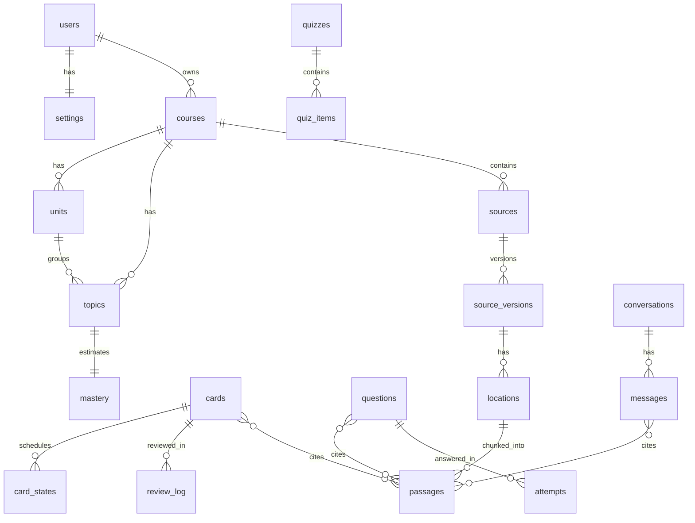

# Studyflare — Database

| | |
|---|---|
| Status | **Approved v1.0**, 2026-11-25 |
| Engine | Cloudflare **D1** (SQLite) + **FTS5**. Blobs in **R2**, embeddings in **Vectorize** ([[ARCHITECTURE]] §4) |
| Implements | [[PRD]]. Algorithm fields are defined in [[AI_SYSTEM]] |

The schema covers **all phases (P0–P4)** and is created in P0, so later phases add features without migrating data (PRD §5).
Tables for later phases stay empty until their features ship.

---

## 1. Conventions
- **IDs:** `TEXT` UUIDv7, generated in the Worker. They sort by time and are safe to expose.
  Tables are normal rowid tables (not `WITHOUT ROWID`), so FTS5 can use the implicit `rowid`.
- **Time:** `INTEGER` Unix **milliseconds UTC** (`*_at`). Calendar dates for planning are `TEXT 'YYYY-MM-DD'` in America/New_York.
- **Booleans:** `INTEGER` 0/1 with a `CHECK (x IN (0,1))`.
- **Enums:** `TEXT` with a `CHECK (col IN (…))`. These mirror the TypeScript string-union types in `src/shared/types.ts`, since erasable TypeScript means no `enum` (ARCHITECTURE A14).
- **JSON:** `TEXT` with `CHECK (json_valid(col))`. JSON is only for data that's read as a whole and never filtered on.
- **Ownership:** every user-owned table has `user_id`, or reaches it through one parent. Every query is scoped by `user_id` (ARCHITECTURE §9).
- **Deletes:**
  - Sources, cards and questions are **soft-deleted** (`deleted_at`). A nightly job hard-deletes them after 30 days, along with their R2 objects and vectors.
  - `review_log` and `attempts` are **append-only** and are never deleted while their item exists.
- **Foreign keys:** declared everywhere, with `ON DELETE CASCADE` only where a child has no meaning without its parent.
  **Verified 2026-11-26:** D1 enforces FKs by default. A probe insert with an unknown `user_id` was rejected on both production and preview.
- **D1 limits to respect:**
  - 2 MB per row or string
  - 100 KB per SQL statement
  - **100 bound parameters per query**, so bulk inserts are batched with `db.batch()` in chunks
  - 10 GB per database on Paid
- **No seed data in migrations** (NFR-DATA, Prizm rule). Fixtures live in `tests/fixtures/`.
  - **The production database starts empty** (`LIB-12`): migrations create schema only. There are no built-in courses, topics, subject lists or sample sources.
  - First sign-in inserts only the `users` row and a default `settings` row.
  - A migration test asserts every content table has 0 rows after `0001_init.sql`.
  - The college directory is **not** in D1. It's a static asset (ARCHITECTURE A16).
- **Migrations:** forward-only, numbered `migrations/NNNN_name.sql`, applied in CI/deploy. Never edit a migration that has been applied.
- **Creation order in `0001_init.sql`:** §3 groups tables by feature, not by dependency. The migration must create referenced tables first:
  `users → settings → generations → ai_usage → courses → units → topics → tags → sources → … → plan_blocks → study_sessions → cards → … → review_log`.
  A test applies the migrations to an empty database.

## 2. Entity overview



## 3. Tables

### 3.1 Identity & settings (P0)
```sql
CREATE TABLE users (
  id TEXT PRIMARY KEY,
  email TEXT NOT NULL UNIQUE,              -- lowercased, from the verified Access JWT
  display_name TEXT,
  created_at INTEGER NOT NULL
);

-- Every sign-in email that belongs to a user. Studyflare is single-user (PRD §2): all of Alex's allowed
-- emails (school and personal) link to the ONE owner row, so either login shows the same library.
-- CI and dev identities get their own users.
CREATE TABLE user_emails (
  email TEXT PRIMARY KEY,                  -- lowercased
  user_id TEXT NOT NULL REFERENCES users(id) ON DELETE CASCADE,
  created_at INTEGER NOT NULL
);

CREATE TABLE settings (
  user_id TEXT PRIMARY KEY REFERENCES users(id) ON DELETE CASCADE,
  style TEXT NOT NULL DEFAULT 'paper' CHECK (style IN ('paper','lab','midnight')),            -- UX-01, DESIGN §2.8
  home_unitid TEXT,                         -- federal UNITID of the home school; NULL = not chosen yet, or a "Not listed" school (INS-01)
  home_institution_name TEXT,               -- name snapshot (directory) or typed name ("Not listed")
  home_institution_domain TEXT,             -- e.g. 'umbc.edu'; used for catalog lookups (INS-03)
  theme TEXT NOT NULL DEFAULT 'system' CHECK (theme IN ('system','light','dark')),
  reading_json TEXT NOT NULL DEFAULT '{}' CHECK (json_valid(reading_json)),   -- reading + appearance prefs: font, sizePct, letterSpacingEm, lineHeight, widthCh, reduceMotion, shortcuts (UX-03; validated by src/shared/settings.ts)
  daily_minutes INTEGER NOT NULL DEFAULT 20 CHECK (daily_minutes BETWEEN 5 AND 600),   -- CRD-06
  target_retention REAL NOT NULL DEFAULT 0.90 CHECK (target_retention BETWEEN 0.70 AND 0.97), -- CRD-05
  fsrs_version TEXT NOT NULL DEFAULT 'fsrs-6',
  fsrs_params_json TEXT CHECK (fsrs_params_json IS NULL OR json_valid(fsrs_params_json)),  -- NULL = library defaults (CRD-10)
  assistant_mode TEXT NOT NULL DEFAULT 'direct' CHECK (assistant_mode IN ('direct','tutor')), -- AST-06
  mixed_privacy_mode TEXT NOT NULL DEFAULT 'private_all' CHECK (mixed_privacy_mode IN ('private_all','gemini_published_only')), -- PRV-03, AI_SYSTEM §4
  interleave_default INTEGER NOT NULL DEFAULT 1 CHECK (interleave_default IN (0,1)),       -- ADP-03
  session_json TEXT NOT NULL DEFAULT '{}' CHECK (json_valid(session_json)),               -- pomodoro lengths etc.
  updated_at INTEGER NOT NULL
);
```

### 3.2 Organisation (P1) — `LIB-01`
```sql
CREATE TABLE courses (
  id TEXT PRIMARY KEY, user_id TEXT NOT NULL REFERENCES users(id),
  name TEXT NOT NULL,                       -- display name (defaults to official_title)
  institution_unitid TEXT,                  -- INS-02: defaults to the home school; NULL for "Not listed"
  institution_name TEXT NOT NULL,           -- name snapshot, so directory updates never break a course (INS-07)
  institution_domain TEXT,
  subject_code TEXT,                        -- normalised, e.g. 'CHEM'
  course_number TEXT,                       -- e.g. '101', '201L'
  official_title TEXT,                      -- from the catalog (P2) or typed (P1)
  credits REAL,
  catalog_source_id TEXT,                   -- the catalog page saved as a published source (INS-03); logical FK to sources(id)
  code_verified INTEGER NOT NULL DEFAULT 0 CHECK (code_verified IN (0,1)),  -- 1 = code and title found word for word on the school's own site
  term TEXT, color TEXT,
  archived_at INTEGER, created_at INTEGER NOT NULL, updated_at INTEGER NOT NULL
);
CREATE INDEX idx_courses_code ON courses(user_id, institution_unitid, subject_code, course_number);

-- INS-06: cache of confirmed catalog lookups (per user; only Alex's lookups, never pre-filled)
CREATE TABLE catalog_courses (
  id TEXT PRIMARY KEY, user_id TEXT NOT NULL REFERENCES users(id),
  institution_key TEXT NOT NULL,            -- unitid, or 'custom:<domain or name>'
  subject_code TEXT NOT NULL, course_number TEXT NOT NULL,
  title TEXT NOT NULL, credits REAL, description TEXT, prerequisites TEXT,
  url TEXT NOT NULL, fetched_at INTEGER NOT NULL,
  UNIQUE (user_id, institution_key, subject_code, course_number)
);
CREATE TABLE units (
  id TEXT PRIMARY KEY, course_id TEXT NOT NULL REFERENCES courses(id) ON DELETE CASCADE,
  name TEXT NOT NULL, position INTEGER NOT NULL
);
CREATE TABLE topics (
  id TEXT PRIMARY KEY, course_id TEXT NOT NULL REFERENCES courses(id) ON DELETE CASCADE,
  unit_id TEXT REFERENCES units(id) ON DELETE SET NULL,
  name TEXT NOT NULL, description TEXT, position INTEGER NOT NULL,
  created_at INTEGER NOT NULL
);
CREATE TABLE tags (
  id TEXT PRIMARY KEY, user_id TEXT NOT NULL REFERENCES users(id),
  name TEXT NOT NULL, UNIQUE (user_id, name)
);
-- Polymorphic tag links (sources, cards, questions, notes)
CREATE TABLE entity_tags (
  tag_id TEXT NOT NULL REFERENCES tags(id) ON DELETE CASCADE,
  entity_type TEXT NOT NULL CHECK (entity_type IN ('source','card','question')),
  entity_id TEXT NOT NULL,
  PRIMARY KEY (tag_id, entity_type, entity_id)
);
CREATE INDEX idx_entity_tags_entity ON entity_tags(entity_type, entity_id);
```

### 3.3 Sources, versions, locations, passages (P1) — `LIB-02..11`, `PRV-01`, `LKP-02..04`
```sql
CREATE TABLE sources (
  id TEXT PRIMARY KEY, user_id TEXT NOT NULL REFERENCES users(id),
  course_id TEXT REFERENCES courses(id) ON DELETE SET NULL,
  title TEXT NOT NULL,
  kind TEXT NOT NULL CHECK (kind IN ('pdf','docx','pptx','md','image','web','note','primer')),
  origin TEXT NOT NULL CHECK (origin IN ('upload','obsidian','lookup_search','lookup_url','app_note','ai_primer','catalog')),  -- 'catalog' = school catalog page (INS-03)
  privacy TEXT NOT NULL CHECK (privacy IN ('personal','published')),            -- PRV-01
  citeable INTEGER NOT NULL DEFAULT 1 CHECK (citeable IN (0,1)),                -- 0 for ai_primer (LKP-04)
  user_vetted INTEGER NOT NULL DEFAULT 0 CHECK (user_vetted IN (0,1)),          -- LKP-03
  origin_url TEXT, retrieved_at INTEGER,                                        -- web sources
  alt_rendition_of TEXT REFERENCES sources(id) ON DELETE SET NULL,              -- PDF export attached to a PPTX/DOCX
  current_version_id TEXT,                                                       -- FK added logically; set after first version
  deleted_at INTEGER, created_at INTEGER NOT NULL, updated_at INTEGER NOT NULL,
  CHECK (NOT (origin = 'ai_primer' AND citeable = 1))
);
CREATE INDEX idx_sources_user_course ON sources(user_id, course_id) WHERE deleted_at IS NULL;

CREATE TABLE source_topics (
  source_id TEXT NOT NULL REFERENCES sources(id) ON DELETE CASCADE,
  topic_id  TEXT NOT NULL REFERENCES topics(id)  ON DELETE CASCADE,
  PRIMARY KEY (source_id, topic_id)
);

CREATE TABLE source_versions (
  id TEXT PRIMARY KEY, source_id TEXT NOT NULL REFERENCES sources(id) ON DELETE CASCADE,
  version_no INTEGER NOT NULL,
  content_hash TEXT NOT NULL,                 -- SHA-256 of the original bytes (LIB-11 duplicate detection)
  r2_key TEXT NOT NULL, mime TEXT NOT NULL, bytes INTEGER NOT NULL,
  location_count INTEGER,
  status TEXT NOT NULL CHECK (status IN ('uploading','queued','extracting','ocr','indexing','embedding','ready','failed')),
  status_detail TEXT,                         -- e.g. "OCR 12/40", "waiting for free quota until 00:00 UTC", failure reason
  workflow_instance_id TEXT,
  created_at INTEGER NOT NULL, ready_at INTEGER,
  UNIQUE (source_id, version_no)
);
CREATE INDEX idx_versions_hash ON source_versions(content_hash);

CREATE TABLE locations (
  id TEXT PRIMARY KEY,
  source_version_id TEXT NOT NULL REFERENCES source_versions(id) ON DELETE CASCADE,
  ordinal INTEGER NOT NULL,                   -- page / slide number, or heading order
  kind TEXT NOT NULL CHECK (kind IN ('page','slide','heading','region')),
  label TEXT NOT NULL,                        -- display: "p. 12", "Slide 4", "Ch 2 › Section 2.3"
  image_key TEXT,                             -- R2 key of the page/slide image (ARCHITECTURE A5)
  extraction TEXT NOT NULL CHECK (extraction IN ('text','ocr')),
  ocr_confidence REAL,                        -- 0..1, NULL if extraction='text'
  content_hash TEXT NOT NULL,                 -- carries studied state across versions
  studied TEXT NOT NULL DEFAULT 'unread' CHECK (studied IN ('unread','read','reviewed')),  -- LIB-09
  studied_manual INTEGER NOT NULL DEFAULT 0 CHECK (studied_manual IN (0,1)),
  UNIQUE (source_version_id, ordinal)
);

CREATE TABLE passages (
  id TEXT PRIMARY KEY,                        -- also the Vectorize vector id
  user_id TEXT NOT NULL REFERENCES users(id),
  source_id TEXT NOT NULL REFERENCES sources(id) ON DELETE CASCADE,
  source_version_id TEXT NOT NULL REFERENCES source_versions(id) ON DELETE CASCADE,
  location_id TEXT NOT NULL REFERENCES locations(id) ON DELETE CASCADE,
  ordinal INTEGER NOT NULL,                   -- order within the location
  text TEXT NOT NULL,                         -- Markdown + LaTeX
  content_hash TEXT NOT NULL,                 -- normalised-text hash, used for version diffs (SRC-01)
  char_start INTEGER, char_end INTEGER,       -- offsets within the location's extracted text
  bbox_json TEXT CHECK (bbox_json IS NULL OR json_valid(bbox_json)),  -- highlight boxes, PDF only
  token_count INTEGER NOT NULL,
  privacy TEXT NOT NULL CHECK (privacy IN ('personal','published')),  -- denormalised from sources, kept in sync on change
  citeable INTEGER NOT NULL CHECK (citeable IN (0,1)),                -- denormalised from sources
  embedded_at INTEGER,                        -- NULL until it's in Vectorize
  is_current INTEGER NOT NULL DEFAULT 1 CHECK (is_current IN (0,1)) -- 0 once superseded by a newer version
);
CREATE INDEX idx_passages_version ON passages(source_version_id, ordinal);
CREATE INDEX idx_passages_current ON passages(user_id, is_current, privacy);

-- Keyword index (ARCHITECTURE A6). External-content FTS5, kept in sync by triggers.
CREATE VIRTUAL TABLE passages_fts USING fts5(
  text, content='passages', content_rowid='rowid', tokenize='porter unicode61'
);
CREATE TRIGGER passages_ai AFTER INSERT ON passages BEGIN
  INSERT INTO passages_fts(rowid, text) VALUES (new.rowid, new.text); END;
CREATE TRIGGER passages_ad AFTER DELETE ON passages BEGIN
  INSERT INTO passages_fts(passages_fts, rowid, text) VALUES ('delete', old.rowid, old.text); END;
CREATE TRIGGER passages_au AFTER UPDATE OF text ON passages BEGIN
  INSERT INTO passages_fts(passages_fts, rowid, text) VALUES ('delete', old.rowid, old.text);
  INSERT INTO passages_fts(rowid, text) VALUES (new.rowid, new.text); END;

-- Notes written in the app (LIB-08) are sources with kind='note'. This holds the editable body.
CREATE TABLE notes (
  source_id TEXT PRIMARY KEY REFERENCES sources(id) ON DELETE CASCADE,
  body_md TEXT NOT NULL,
  dirty INTEGER NOT NULL DEFAULT 0 CHECK (dirty IN (0,1)),   -- 1 = edited since the last indexed version
  updated_at INTEGER NOT NULL
);
```
**Note versioning:** saving the body updates `notes` immediately. A new `source_version` (and re-index) is created when the note has been idle for 2 minutes or when Alex closes it. This avoids a version per keystroke.

**Vectorize index `passages-v1`:**
- 768 dimensions (cosine), using model `bge-base-en-v1.5` ([[AI_SYSTEM]] §3).
- Metadata: `user_id`, `course_id`, `source_id`, `privacy`, `is_current`, with metadata indexes on `user_id`, `course_id` and `privacy`.
- The index name includes a version, so changing the embedding model means a new index plus a re-embed job, never mixed vectors.

### 3.4 Flashcards & review (P1) — `CRD-*`, `SRC-*`
```sql
CREATE TABLE cards (
  id TEXT PRIMARY KEY, user_id TEXT NOT NULL REFERENCES users(id),
  course_id TEXT REFERENCES courses(id) ON DELETE SET NULL,
  type TEXT NOT NULL CHECK (type IN ('basic','cloze','worked','occlusion')),
  front_md TEXT NOT NULL,                   -- cloze: text with {{c1::…}} markers; occlusion: caption
  back_md TEXT,                             -- basic/worked: answer or solution
  data_json TEXT NOT NULL DEFAULT '{}' CHECK (json_valid(data_json)),
     -- worked: {steps:[…]}; cloze: {deletions:[1,2]}; occlusion (P2): {image_key, masks:[{id,x,y,w,h,label}]}
  reversible INTEGER NOT NULL DEFAULT 0 CHECK (reversible IN (0,1)),
  origin TEXT NOT NULL CHECK (origin IN ('manual','ai','assistant_answer','quiz_miss')),
  generation_id TEXT REFERENCES generations(id),
  status TEXT NOT NULL DEFAULT 'active' CHECK (status IN ('pending_review','active','suspended','retired')),
  deleted_at INTEGER, created_at INTEGER NOT NULL, updated_at INTEGER NOT NULL
);
CREATE TABLE card_topics (
  card_id TEXT NOT NULL REFERENCES cards(id) ON DELETE CASCADE,
  topic_id TEXT NOT NULL REFERENCES topics(id) ON DELETE CASCADE,
  PRIMARY KEY (card_id, topic_id)
);
-- CRD-02: which passages a card came from, with the supporting quote
CREATE TABLE card_sources (
  card_id TEXT NOT NULL REFERENCES cards(id) ON DELETE CASCADE,
  passage_id TEXT NOT NULL REFERENCES passages(id),
  quote TEXT NOT NULL,                      -- exact supporting span, checked by the citation verifier
  PRIMARY KEY (card_id, passage_id)
);

-- One schedulable unit per card × variant: cloze deletion N, reverse side, or occlusion mask
CREATE TABLE card_states (
  card_id TEXT NOT NULL REFERENCES cards(id) ON DELETE CASCADE,
  variant TEXT NOT NULL DEFAULT 'main',     -- 'main' | 'reverse' | 'c1'.. | 'm:<maskId>'
  user_id TEXT NOT NULL REFERENCES users(id),
  state TEXT NOT NULL CHECK (state IN ('new','learning','review','relearning')),
  due_at INTEGER NOT NULL,
  stability REAL, difficulty REAL,          -- FSRS memory state
  elapsed_days REAL, scheduled_days REAL,
  reps INTEGER NOT NULL DEFAULT 0, lapses INTEGER NOT NULL DEFAULT 0,
  last_review_at INTEGER,
  PRIMARY KEY (card_id, variant)
);
CREATE INDEX idx_card_states_due ON card_states(user_id, due_at);

-- Append-only raw log: the source of truth (CRD-05, ARCHITECTURE A11). Card state can be rebuilt from it.
CREATE TABLE review_log (
  id TEXT PRIMARY KEY, user_id TEXT NOT NULL REFERENCES users(id),
  card_id TEXT NOT NULL REFERENCES cards(id),
  variant TEXT NOT NULL,
  rating INTEGER NOT NULL CHECK (rating BETWEEN 1 AND 4),   -- Again/Hard/Good/Easy
  reviewed_at INTEGER NOT NULL,
  duration_ms INTEGER,
  state_before TEXT NOT NULL, stability_before REAL, difficulty_before REAL,
  scheduled_days REAL NOT NULL,             -- interval the scheduler chose
  fsrs_version TEXT NOT NULL, params_hash TEXT NOT NULL,   -- which algorithm and parameters made the decision
  session_id TEXT REFERENCES study_sessions(id),
  client_id TEXT NOT NULL UNIQUE            -- idempotency key from the client (safe to retry)
);
CREATE INDEX idx_review_log_card ON review_log(card_id, reviewed_at);
CREATE INDEX idx_review_log_user_time ON review_log(user_id, reviewed_at);

-- SRC-01/02: items whose source passage changed
CREATE TABLE source_change_flags (
  id TEXT PRIMARY KEY, user_id TEXT NOT NULL REFERENCES users(id),
  item_type TEXT NOT NULL CHECK (item_type IN ('card','question')),
  item_id TEXT NOT NULL,
  old_passage_id TEXT NOT NULL REFERENCES passages(id),
  new_passage_id TEXT REFERENCES passages(id),             -- NULL = removed
  change TEXT NOT NULL CHECK (change IN ('modified','removed')),
  status TEXT NOT NULL DEFAULT 'open' CHECK (status IN ('open','kept','edited','regenerated','retired')),
  created_at INTEGER NOT NULL, resolved_at INTEGER
);
CREATE INDEX idx_flags_open ON source_change_flags(user_id, status);
```
Superseded passages are kept (`is_current = 0`) while any card, question, citation or flag refers to them, so old citations always resolve.

### 3.5 Assistant (P1) — `AST-*`
```sql
CREATE TABLE conversations (
  id TEXT PRIMARY KEY, user_id TEXT NOT NULL REFERENCES users(id),
  course_id TEXT REFERENCES courses(id) ON DELETE SET NULL,
  topic_id TEXT REFERENCES topics(id) ON DELETE SET NULL,
  title TEXT NOT NULL,
  mode TEXT NOT NULL CHECK (mode IN ('direct','tutor')),
  scope_json TEXT NOT NULL DEFAULT '{}' CHECK (json_valid(scope_json)),  -- {source_ids:[…]} limit (AST-08)
  created_at INTEGER NOT NULL, updated_at INTEGER NOT NULL
);
CREATE TABLE messages (
  id TEXT PRIMARY KEY, conversation_id TEXT NOT NULL REFERENCES conversations(id) ON DELETE CASCADE,
  role TEXT NOT NULL CHECK (role IN ('user','assistant')),
  content_md TEXT NOT NULL,                 -- the assistant message after verification
  segments_json TEXT CHECK (segments_json IS NULL OR json_valid(segments_json)),
     -- [{kind:'sourced'|'general'|'unverified'|'notice', text, citation_ids:[…]}] (AST-02/03, AI_SYSTEM §5.2)
  coverage TEXT CHECK (coverage IN ('covered','partial','not_found')),   -- AST-05
  provider TEXT, model TEXT,
  privacy_route TEXT CHECK (privacy_route IN ('published_only','private_all','no_context')),  -- PRV-03 disclosure
  generation_id TEXT REFERENCES generations(id),
  created_at INTEGER NOT NULL
);
CREATE TABLE message_citations (
  id TEXT PRIMARY KEY, message_id TEXT NOT NULL REFERENCES messages(id) ON DELETE CASCADE,
  passage_id TEXT NOT NULL REFERENCES passages(id),
  quote TEXT NOT NULL,
  verified INTEGER NOT NULL CHECK (verified IN (0,1)),   -- AST-02. Unverified rows are kept for metrics, never shown as citations
  match_score REAL                                       -- 1.0 exact, <1 fuzzy (AI_SYSTEM §5)
);
```

### 3.6 AI provenance & usage (P0)
```sql
-- One row per AI generation job: cards, questions, answers, OCR, primers, grading
CREATE TABLE generations (
  id TEXT PRIMARY KEY, user_id TEXT NOT NULL REFERENCES users(id),
  task TEXT NOT NULL,                       -- 'chat','gen_cards','gen_questions','validate','grade','ocr','primer'
  provider TEXT NOT NULL, model TEXT NOT NULL,
  prompt_version TEXT NOT NULL,             -- e.g. 'gen_cards@3' (AI_SYSTEM §9)
  effective_privacy TEXT NOT NULL CHECK (effective_privacy IN ('personal','published')),
  input_passage_ids_json TEXT NOT NULL DEFAULT '[]' CHECK (json_valid(input_passage_ids_json)),
  produced INTEGER NOT NULL DEFAULT 0, accepted INTEGER NOT NULL DEFAULT 0, rejected INTEGER NOT NULL DEFAULT 0,
  rejection_reasons_json TEXT NOT NULL DEFAULT '{}' CHECK (json_valid(rejection_reasons_json)),
  input_tokens INTEGER, output_tokens INTEGER, latency_ms INTEGER,
  created_at INTEGER NOT NULL
);
CREATE TABLE ai_usage (
  user_id TEXT NOT NULL REFERENCES users(id),
  day TEXT NOT NULL,                        -- UTC date: free tiers reset at 00:00 UTC
  provider TEXT NOT NULL, task TEXT NOT NULL,
  requests INTEGER NOT NULL DEFAULT 0, input_tokens INTEGER NOT NULL DEFAULT 0,
  output_tokens INTEGER NOT NULL DEFAULT 0, neurons REAL NOT NULL DEFAULT 0,
  PRIMARY KEY (user_id, day, provider, task)
);
```

### 3.7 Questions, quizzes, exams (P2/P3) — `QZ-*`, `EXM-*`, `ADP-*`
```sql
CREATE TABLE questions (
  id TEXT PRIMARY KEY, user_id TEXT NOT NULL REFERENCES users(id),
  course_id TEXT REFERENCES courses(id) ON DELETE SET NULL,
  format TEXT NOT NULL CHECK (format IN ('mcq','tf','short','numeric','multistep')),
  stem_md TEXT NOT NULL,
  payload_json TEXT NOT NULL CHECK (json_valid(payload_json)),
    -- mcq: {options:[{id,text}], correct:[id], distractor_checks:{id:'unsupported'}}
    -- tf: {answer:bool}; short: {accepted:[…], rubric:[…]}
    -- numeric: {answer_latex, value?, tolerance:{abs?,rel?}, units?, equivalence:'numeric'|'symbolic'}
    -- multistep: {steps:[{prompt, answer, points, rubric}]}
  difficulty_level INTEGER CHECK (difficulty_level BETWEEN 1 AND 5),  -- level requested at generation time
  elo_b REAL NOT NULL DEFAULT 0, elo_b_n INTEGER NOT NULL DEFAULT 0,  -- item difficulty + count (ADP-01)
  origin TEXT NOT NULL CHECK (origin IN ('manual','ai')),
  generation_id TEXT REFERENCES generations(id),
  status TEXT NOT NULL DEFAULT 'active' CHECK (status IN ('pending_review','active','retired')),
  deleted_at INTEGER, created_at INTEGER NOT NULL
);
CREATE TABLE question_topics (
  question_id TEXT NOT NULL REFERENCES questions(id) ON DELETE CASCADE,
  topic_id TEXT NOT NULL REFERENCES topics(id) ON DELETE CASCADE,
  PRIMARY KEY (question_id, topic_id)
);
CREATE TABLE question_sources (
  question_id TEXT NOT NULL REFERENCES questions(id) ON DELETE CASCADE,
  passage_id TEXT NOT NULL REFERENCES passages(id),
  quote TEXT NOT NULL,
  PRIMARY KEY (question_id, passage_id)
);
CREATE TABLE quizzes (
  id TEXT PRIMARY KEY, user_id TEXT NOT NULL REFERENCES users(id),
  kind TEXT NOT NULL CHECK (kind IN ('quiz','exam')),
  title TEXT NOT NULL,
  config_json TEXT NOT NULL CHECK (json_valid(config_json)),   -- QZ-02 / EXM-01 settings
  time_limit_s INTEGER,
  started_at INTEGER, submitted_at INTEGER,
  score REAL,                               -- 0..1, after grading
  analysis_json TEXT CHECK (analysis_json IS NULL OR json_valid(analysis_json)),  -- EXM-03 weak-area output
  created_at INTEGER NOT NULL
);
CREATE TABLE quiz_items (
  quiz_id TEXT NOT NULL REFERENCES quizzes(id) ON DELETE CASCADE,
  position INTEGER NOT NULL,
  question_id TEXT NOT NULL REFERENCES questions(id),
  PRIMARY KEY (quiz_id, position)
);
-- Append-only answers (also feeds mastery)
CREATE TABLE attempts (
  id TEXT PRIMARY KEY, user_id TEXT NOT NULL REFERENCES users(id),
  question_id TEXT NOT NULL REFERENCES questions(id),
  quiz_id TEXT REFERENCES quizzes(id),
  session_id TEXT REFERENCES study_sessions(id),
  response_json TEXT NOT NULL CHECK (json_valid(response_json)),
  auto_score REAL,                          -- deterministic grading result, 0..1
  ai_suggested_score REAL, ai_rubric_json TEXT CHECK (ai_rubric_json IS NULL OR json_valid(ai_rubric_json)),
  final_score REAL NOT NULL,                -- what counts
  overridden INTEGER NOT NULL DEFAULT 0 CHECK (overridden IN (0,1)),   -- QZ-04
  answered_at INTEGER NOT NULL, duration_ms INTEGER,
  client_id TEXT NOT NULL UNIQUE
);
CREATE INDEX idx_attempts_question ON attempts(question_id, answered_at);
CREATE INDEX idx_attempts_user_time ON attempts(user_id, answered_at);

-- ADP-01/02: current per-topic estimate
CREATE TABLE mastery (
  user_id TEXT NOT NULL REFERENCES users(id),
  topic_id TEXT NOT NULL REFERENCES topics(id) ON DELETE CASCADE,
  theta REAL NOT NULL DEFAULT 0,
  theta_var REAL NOT NULL DEFAULT 1.0,      -- uncertainty, which gives the confidence band
  evidence_count INTEGER NOT NULL DEFAULT 0,
  updated_at INTEGER NOT NULL,
  PRIMARY KEY (user_id, topic_id)
);
-- Daily snapshot for trends (ANL-01)
CREATE TABLE mastery_history (
  user_id TEXT NOT NULL, topic_id TEXT NOT NULL REFERENCES topics(id) ON DELETE CASCADE,
  day TEXT NOT NULL, theta REAL NOT NULL, theta_var REAL NOT NULL, evidence_count INTEGER NOT NULL,
  PRIMARY KEY (user_id, topic_id, day)
);
```

### 3.8 Planner, sessions (P3) — `PLN-*`
```sql
CREATE TABLE deadlines (
  id TEXT PRIMARY KEY, user_id TEXT NOT NULL REFERENCES users(id),
  course_id TEXT REFERENCES courses(id) ON DELETE CASCADE,
  title TEXT NOT NULL,
  kind TEXT NOT NULL CHECK (kind IN ('exam','quiz','assignment','other')),
  due_at INTEGER NOT NULL,
  origin TEXT NOT NULL CHECK (origin IN ('manual','ics')),
  ics_uid TEXT,                             -- re-importing the same .ics updates instead of duplicating
  created_at INTEGER NOT NULL,
  UNIQUE (user_id, ics_uid)
);
CREATE TABLE deadline_topics (
  deadline_id TEXT NOT NULL REFERENCES deadlines(id) ON DELETE CASCADE,
  topic_id TEXT NOT NULL REFERENCES topics(id) ON DELETE CASCADE,
  PRIMARY KEY (deadline_id, topic_id)
);
CREATE TABLE goals (
  id TEXT PRIMARY KEY, user_id TEXT NOT NULL REFERENCES users(id),
  kind TEXT NOT NULL CHECK (kind IN ('master_topics','daily_minutes','custom')),
  target_json TEXT NOT NULL CHECK (json_valid(target_json)),
  due_on TEXT, status TEXT NOT NULL DEFAULT 'active' CHECK (status IN ('active','met','dropped')),
  created_at INTEGER NOT NULL
);
CREATE TABLE plan_blocks (
  id TEXT PRIMARY KEY, user_id TEXT NOT NULL REFERENCES users(id),
  day TEXT NOT NULL,
  planned_minutes INTEGER NOT NULL,
  focus_json TEXT NOT NULL CHECK (json_valid(focus_json)),    -- topics, due cards, quiz suggestion
  reason TEXT NOT NULL,                     -- why it was recommended (PLN-03 explainability)
  status TEXT NOT NULL DEFAULT 'proposed' CHECK (status IN ('proposed','accepted','done','skipped')),
  created_at INTEGER NOT NULL
);
CREATE TABLE study_sessions (
  id TEXT PRIMARY KEY, user_id TEXT NOT NULL REFERENCES users(id),
  plan_block_id TEXT REFERENCES plan_blocks(id),
  started_at INTEGER NOT NULL, ended_at INTEGER,
  active_ms INTEGER NOT NULL DEFAULT 0,     -- excludes idle time over 2 minutes
  pomodoro INTEGER NOT NULL DEFAULT 0 CHECK (pomodoro IN (0,1)),
  interleaved INTEGER NOT NULL DEFAULT 1 CHECK (interleaved IN (0,1))
);
```
In P1, `study_sessions` already records review sessions, so time-on-task data exists before the P3 planner ships.

### 3.9 Lookup & ops (P2 / P0)
```sql
CREATE TABLE lookups (
  id TEXT PRIMARY KEY, user_id TEXT NOT NULL REFERENCES users(id),
  query TEXT NOT NULL,
  results_json TEXT NOT NULL CHECK (json_valid(results_json)),  -- results after filtering, with the domain tier
  rejected_json TEXT NOT NULL DEFAULT '[]' CHECK (json_valid(rejected_json)),  -- what the allowlist removed, for audit (A10)
  created_at INTEGER NOT NULL
);
CREATE TABLE backups (
  id TEXT PRIMARY KEY, r2_key TEXT NOT NULL, bytes INTEGER,
  schema_version INTEGER NOT NULL,
  status TEXT NOT NULL CHECK (status IN ('ok','failed')), detail TEXT,
  created_at INTEGER NOT NULL
);
CREATE TABLE schema_meta (key TEXT PRIMARY KEY, value TEXT NOT NULL);  -- e.g. ('export_schema_version','1')

-- Added in migration 0008 (2026-11-27): processed material for AI (step 5, ARCHITECTURE A24). The browser
-- builds one encrypted bundle per source (passages + vectors) in R2 at index/<user>/<source>; this row
-- records that it exists and which content fingerprint it was built from.
CREATE TABLE source_index (
  source_id TEXT PRIMARY KEY REFERENCES sources(id) ON DELETE CASCADE,
  user_id TEXT NOT NULL REFERENCES users(id) ON DELETE CASCADE,
  fingerprint TEXT NOT NULL,
  passages INTEGER NOT NULL CHECK (passages >= 0),
  embed_model TEXT NOT NULL,
  bytes INTEGER NOT NULL,
  updated_at INTEGER NOT NULL
);

-- Migration 0007 (2026-11-27): flashcard review (step 4, ARCHITECTURE A23).
-- ALTER TABLE settings ADD COLUMN new_per_day INTEGER NOT NULL DEFAULT 20 CHECK (new_per_day BETWEEN 0 AND 200);
-- ALTER TABLE card_states ADD COLUMN learning_steps INTEGER NOT NULL DEFAULT 0;   -- FSRS 6 (re)learning step position
-- CREATE INDEX idx_card_states_new ON card_states(user_id, state);
-- CREATE INDEX idx_deadlines_user_due ON deadlines(user_id, due_at);
-- Cards: front_md = encrypted payload (sf1, AAD "<card id>#card"); back_md NULL; data_json '{}'. Typed answers
-- are type 'basic' with answerMode 'typed' INSIDE the payload. Exams are `deadlines` rows (kind 'exam',
-- origin 'manual', one per course). Imported links are sources with origin 'lookup_url' (content encrypted).

-- Uploaded files (step 2b, 2026-11-27, ARCHITECTURE A22) use the existing tables, no migration:
--   sources: kind pdf/docx/pptx/image/md, origin 'upload', privacy 'personal', title = sf1 envelope
--            (AAD "<source id>#title"), current_version_id → the version below.
--   source_versions: content_hash = HMAC fingerprint (keyed from the data key, NOT a plain SHA-256),
--            r2_key = 'files/<user>/<version>' (chunks at …/<n>), mime, bytes = PLAINTEXT size (chunk count
--            and sizes are derived from it), status 'uploading' → 'ready'.

-- Migration 0006 (2026-11-26): personal courses (LIB-01b), a subject studied for its own sake with no school
-- and no code. Personal rows keep institution_name = '' (it's NOT NULL) and NULL unitid/domain/code/title.
-- ALTER TABLE courses ADD COLUMN kind TEXT NOT NULL DEFAULT 'college' CHECK (kind IN ('college','personal'));

-- Migration 0002 added `allowed_emails` (Settings → People invites, AUTH-06). Migration 0005 dropped it
-- (2026-11-26, ARCHITECTURE A21): each person now deploys their own Studyflare (AUTH-07).

-- Added in migration 0003 (2026-11-26): deployment settings written by first-run setup (AUTH-07).
-- Used only when the ACCESS_* vars are left as "todo" (one-click deploys). Never holds a token. Not exported.
CREATE TABLE app_config (
  key TEXT PRIMARY KEY CHECK (key IN ('team_domain','aud','account_id','app_id','policy_id','brand_app_id','setup_at')),
  value TEXT NOT NULL,
  updated_at INTEGER NOT NULL
);

-- Added in migration 0004 (2026-11-26): the encryption vault (AUTH-08, ARCHITECTURE A20).
-- Only WRAPPED keys and a key-check ciphertext are stored, so the server can't decrypt anything.
-- Both tables ARE exported: an export is useless without the wrapped key, and the export still needs
-- the passphrase or recovery code to read.
CREATE TABLE vault (
  user_id TEXT PRIMARY KEY REFERENCES users(id) ON DELETE CASCADE,
  version INTEGER NOT NULL DEFAULT 1 CHECK (version = 1),
  kdf TEXT NOT NULL CHECK (kdf IN ('pbkdf2-sha256')),
  pass_iterations INTEGER NOT NULL CHECK (pass_iterations >= 100000),
  pass_salt TEXT NOT NULL,
  pass_wrapped TEXT NOT NULL,
  recovery_iterations INTEGER NOT NULL CHECK (recovery_iterations >= 100000),
  recovery_salt TEXT NOT NULL,
  recovery_wrapped TEXT NOT NULL,
  key_check TEXT NOT NULL,
  created_at INTEGER NOT NULL,
  updated_at INTEGER NOT NULL
);
CREATE TABLE vault_passkeys (
  credential_id TEXT PRIMARY KEY,           -- base64url WebAuthn credential id
  user_id TEXT NOT NULL REFERENCES users(id) ON DELETE CASCADE,
  label TEXT NOT NULL,
  prf_salt TEXT NOT NULL,
  wrapped TEXT NOT NULL,
  created_at INTEGER NOT NULL,
  last_used_at INTEGER
);
```

## 4. Key queries
| Need | Query shape | Index |
|---|---|---|
| Today's review queue | `card_states WHERE user_id=? AND due_at<=? JOIN cards (status='active')`, then interleave by topic in code | `idx_card_states_due` |
| Hybrid search | FTS5 `MATCH ?` with `bm25()` top 30 + Vectorize top 30 (filter on `user_id`, `is_current`, privacy/course), then RRF merge in the Worker | FTS5, Vectorize metadata |
| Citation lookup | `passages JOIN locations JOIN sources` by passage id | PKs |
| Source-change diff | Previous version's passages vs new ones by `content_hash`, then fuzzy-match the unmatched ones | `idx_passages_version` |
| Retention actual vs target | `review_log` with `state_before='review'` grouped by week, share with `rating>1` | `idx_review_log_user_time` |
| Open flags | `source_change_flags WHERE user_id=? AND status='open'` | `idx_flags_open` |

## 5. Export / backup format (`EXP-01`, `EXP-02`)
- One JSON document: `{ export_schema_version, exported_at, user, settings, tables: { courses:[…], …, review_log:[…] } }`.
  - Includes all D1 tables except `passages_fts`, which is rebuilt on restore.
  - Includes extracted passage text.
  - **Excludes** R2 binaries (they stay in R2) and vectors (re-embedded on restore).
- **Restore** goes into an empty database only, re-creates FTS, then queues re-embedding.
  - **As built in T0.15** (`src/worker/backup/`): restore refuses (409) unless the signed-in account has no content.
  - It replaces the empty user row with the exported one and links the current login email to it.
  - Inserts run parents-first (`EXPORT_TABLES`), with at most 100 bound parameters each. `sources.alt_rendition_of` is set in a second pass.
  - Very large restores span several D1 batches. Each batch is atomic, but the whole restore isn't. If one fails partway, the account must be cleared and the restore retried.
  - Uploaded files are validated first: format, version, known tables, plain column names (they end up in SQL), and scalar values only.
- `export_schema_version` goes up whenever a migration changes an exported table. The importer keeps upgrade functions for older versions.
- The nightly backup uses the same serialiser, gzip-compressed, in R2 at `backups/`.

## 6. Phase map
| Phase | Tables first written |
|---|---|
| P0 | users, settings, generations, ai_usage, schema_meta, backups |
| P1 | courses, units, topics, tags, entity_tags, sources, source_topics, source_versions, locations, passages(+fts), notes, cards, card_topics, card_sources, card_states, review_log, source_change_flags, conversations, messages, message_citations, study_sessions |
| P2 | catalog_courses, questions, question_topics, question_sources, quizzes, quiz_items, attempts, mastery, mastery_history, lookups |
| P3 | deadlines, deadline_topics, goals, plan_blocks (+ quizzes with kind='exam') |
